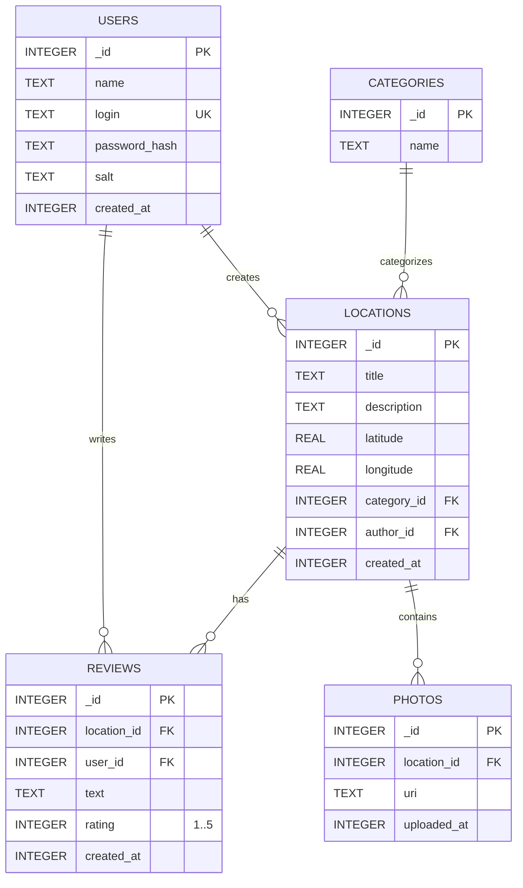

# TourSpots — Сервіс обміну туристичними локаціями (Android)

Мобільний додаток, що послідовно виконує лабораторні роботи 1–5 та реалізує мобільну частину
технічного завдання «Сервіс обміну туристичними локаціями» (див. `TechnicalTaskForProject.pdf`,
`DiagramsForProject.pdf`).

* Мова: **Kotlin**, розмітка — **XML** (View system), ViewBinding
* База даних: **SQLite** (`SQLiteOpenHelper`), без серверної частини
* minSdk 26 (Android 8.0), target/compileSdk 37
* Мови інтерфейсу: українська (за замовчуванням), англійська

## Збирання та запуск

1. Відкрити теку проєкту в Android Studio (Gradle sync підтягне залежності).
2. Створити емулятор: *Device Manager → Create Virtual Device* (наприклад, Pixel 8, API 35).
3. *Run ▶ app*.

З командного рядка (JDK 17+, напр. JBR з Android Studio):

```bash
./gradlew assembleDebug        # APK: app/build/outputs/apk/debug/app-debug.apk
./gradlew testDebugUnitTest    # модульні тести (валідація, хешування паролів, таймер)
./gradlew lintDebug
```

> Шлях до проєкту містить кирилицю, тому в `gradle.properties` увімкнено `android.overridePathCheck=true`.

Кожна лабораторна позначена git-тегом: `lab1` … `lab5`, фінальна версія — `project`
(`git checkout lab3` — стан після 3-ї лабораторної).

## Відповідність лабораторним роботам

| Лаб. | Вимога | Де реалізовано |
|---|---|---|
| 1 | «Hello world», зміна макету й тексту | `res/layout/header_greeting.xml`, `values/strings.xml` (`greeting`) — початковий текст «Hello world» замінено привітанням |
| 1 | Фонові зображення та інші медіа | `android:background="@drawable/bg_main"`, `ImageView` з логотипом, звук `res/raw/intro_sound.wav` (`MediaPlayer`, `MainActivity.playIntroSound`) |
| 2 | Випадаючий список з власним текстом | `Spinner` + `string-array name="categories"` (`card_categories.xml`) |
| 2 | Власна реакція на вибір | список рекомендованих місць (`category_locations` → `locations_*`) |
| 2 | Зміна фонового зображення | `category_backgrounds` у `values/arrays.xml`, `MainActivity.showCategory` |
| 2 | 2 варіанти реакції | кнопка **Button1** (`button1.setOnClickListener`) та без кнопки (`OnItemSelectedListener`); перемикач «Реагувати одразу» |
| 2 | Вибір мови у верхньому правому куті | `Spinner` з прапорами в `Toolbar` (`menu_main.xml`, `LocaleHelper`), `values/strings.xml` + `values-en/strings.xml`, `AppCompatDelegate.setApplicationLocales` |
| 3 | Вікно введення повідомлення | `card_message.xml` |
| 3а | Пересилання в нове вікно додатку | явний `Intent` → `ReceiveMessageActivity` |
| 3б | Пересилання іншими додатками | неявний `Intent.ACTION_SEND` + `Intent.createChooser` |
| 4 | Таймер на основному макеті | `card_stopwatch.xml`, `StopwatchController` |
| 4 | Поворот / зміна розміру екрана | `onSaveInstanceState` / `restoreFrom`, окремий `layout-land/activity_main.xml`; час рахується від `SystemClock.elapsedRealtime()`, тому не «з'їдається» |
| 4 | Перекриття вікном (частково/повністю) | `onPause`/`onResume` — пауза і продовження (`wasRunning`), `onStop`/`onStart`; логування життєвого циклу (`Logcat`, тег `MainActivity`) |
| 5 | Авторизація | `LoginActivity`, `RegisterActivity` |
| 5 | Ім'я та логін у БД | таблиця `users` (`TourDbHelper`, `UserDao`); пароль — PBKDF2 + сіль (`PasswordHasher`) |
| 5 | Контроль часу авторизації таймером | 60 с на введення даних (`LoginActivity`), сесія 5 хв з відліком у `Toolbar` та автоматичним виходом (`SessionManager`, `AuthenticatedActivity`), блокування на 30 с після 3 невдалих спроб |

## Функції технічного завдання (мобільна версія)

| Вимога ТЗ | Реалізація |
|---|---|
| Реєстрація та авторизація | `auth/*` (замість JWT — локальна сесія з обмеженим часом дії) |
| Введення і корекція локацій (назва, координати, опис, фото) | `LocationEditActivity` — точно за діаграмою діяльності: форма → координати → фото (необов'язково) → «Зберегти» → валідація → збереження або повернення до форми |
| Збереження локацій і відгуків | `LocationDao` (транзакції, зовнішні ключі, `CHECK`-обмеження) |
| Пошук, фільтрація за категоріями | `LocationListActivity` (`SearchView` + `ChipGroup`) |
| Перегляд на карті | `geo:`-інтент у будь-який картографічний додаток, запасний варіант — OpenStreetMap у браузері |
| Середній рейтинг | `AVG(rating)` у `LocationDao`, `RatingBar` у `LocationDetailActivity` |
| Відгуки та оцінки | діалог «Оцінити» (один відгук на користувача, повторний — оновлює) |
| Профіль зі списком доданих місць | `ProfileActivity` |
| Контроль введених даних (2.1) | `Validators`, `LocationValidator` + обмеження БД |
| Блокування некоректних дій (2.2) | редагувати/видаляти може лише автор; ліміт спроб входу |
| Цілісність даних (2.3) | транзакції, `FOREIGN KEY … ON DELETE CASCADE`, `PRAGMA foreign_keys` |
| Сховище фото (MinIO) | `PhotoStorage` — файли у приватному сховищі додатку, у БД — шлях |

## Архітектура БД (ER-діаграма)



Вміст БД можна переглянути в Android Studio: *View → Tool Windows → App Inspection → Database Inspector*.

## Структура коду

```
app/src/main/java/ua/chnu/tourspots/
├── MainActivity.kt            Лаб. 1–4 (головний екран)
├── ReceiveMessageActivity.kt  Лаб. 3а
├── StopwatchController.kt     Лаб. 4
├── LocaleHelper.kt            Лаб. 2 (мова)
├── auth/                      Лаб. 5: Login/Register, SessionManager, PasswordHasher, Validators,
│                              AuthenticatedActivity (базовий екран для авторизованого користувача)
├── data/                      TourDbHelper (схема + початкові дані), UserDao, LocationDao
└── locations/                 ТЗ: список, деталі, додавання/редагування, профіль, фото, карта
```

## Довідник користувача

1. **Вхід / реєстрація.** На вхід дається 60 с (індикатор угорі). Немає акаунта — «Зареєструйтеся»:
   ім'я, логін (3–20 латинських символів), пароль ≥ 6 символів. Після 3 невдалих спроб вхід блокується на 30 с.
2. **Головний екран.** Угорі справа — вибір мови (UA/EN) і меню (Локації, Профіль, Вийти).
   У підзаголовку — час, що залишився до кінця сесії (5 хв).
   * Категорії: оберіть зі списку й натисніть «Знайти локації» або ввімкніть «Реагувати одразу».
     «Усі локації категорії» відкриває стрічку.
   * Повідомлення: «Надіслати в додатку» або «Надіслати через…» (Gmail, Telegram, SMS…).
   * Таймер подорожі: Старт / Стоп / Скинути.
3. **Локації.** Пошук (лупа), фільтр-чипи категорій, кнопка «Додати локацію».
4. **Сторінка локації.** Опис, фото, середній рейтинг, відгуки, «На карті», «Поділитися»;
   автор бачить «Редагувати» та «Видалити».
5. **Профіль.** Дані користувача та список його локацій.

## Перевірка (чек-лист для захисту)

* **Л1:** фон і логотип показуються; кнопка зі значком динаміка відтворює звук.
* **Л2:** обидва режими реакції працюють, фон змінюється з категорією; перемикання UA/EN змінює всі
  тексти і зберігається після перезапуску.
* **Л3:** повідомлення відкривається в новому вікні; «Надіслати через…» показує список додатків.
  Порожнє повідомлення — помилка під полем.
* **Л4:** запустіть таймер →
  поверніть екран (Ctrl+←/→ в емуляторі) — час не скидається;
  розділіть екран / змініть розмір вікна — час не скидається;
  відкрийте шторку сповіщень чи діалог (часткове перекриття) і натисніть Home або зробіть вхідний
  виклик (*Extended controls → Phone → Call device*) — таймер стає на паузу й продовжує після повернення
  (або рахує далі, якщо вимкнути «Пауза, коли екран перекрито»). Послідовність викликів — у Logcat.
* **Л5:** реєстрація → вхід; 3 хибні паролі → блокування 30 с; не встигнути увійти за 60 с →
  форма очищається; після 5 хв сесії — автоматичний вихід. Перевірити записи в Database Inspector.
* **ТЗ:** додати локацію з координатою `95` → помилка й повернення до форми; з коректними даними →
  повідомлення «Локацію успішно створено» і відкриття її сторінки; додати відгуки → середній рейтинг
  перераховується; «На карті» відкриває карту.
